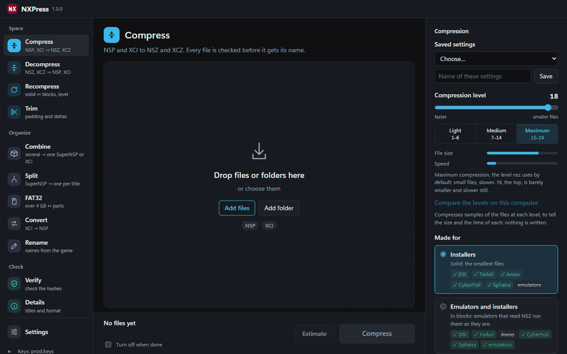
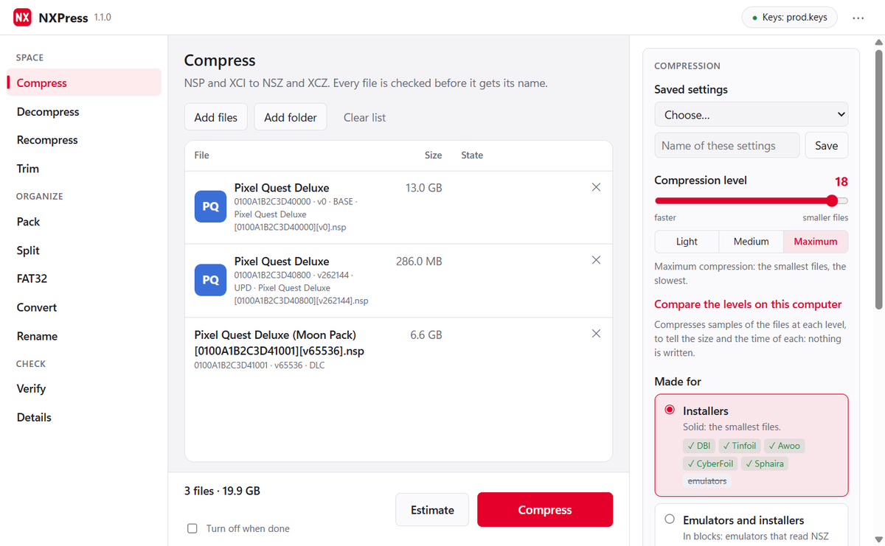
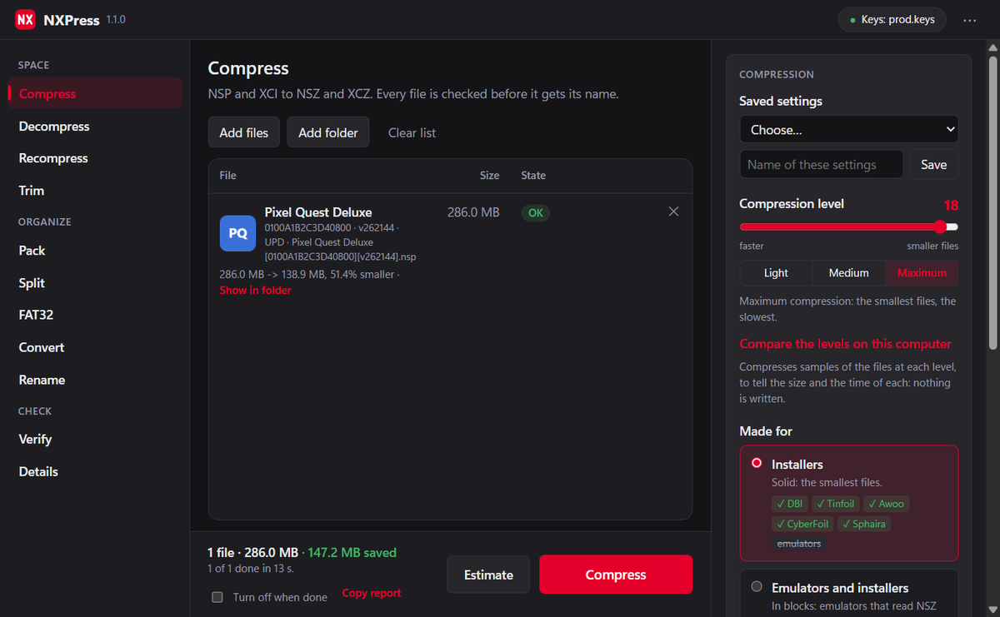
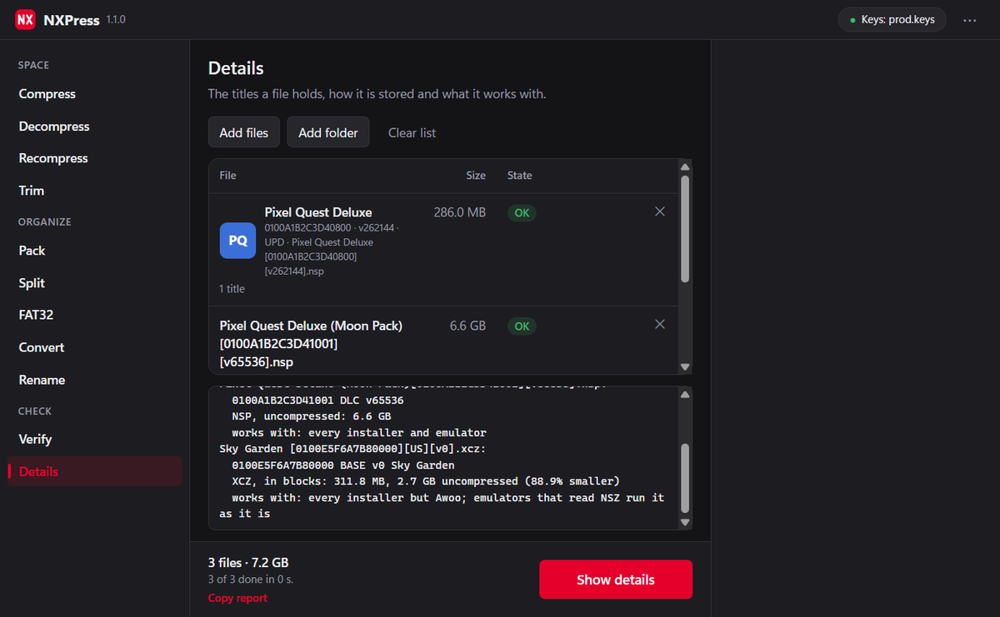
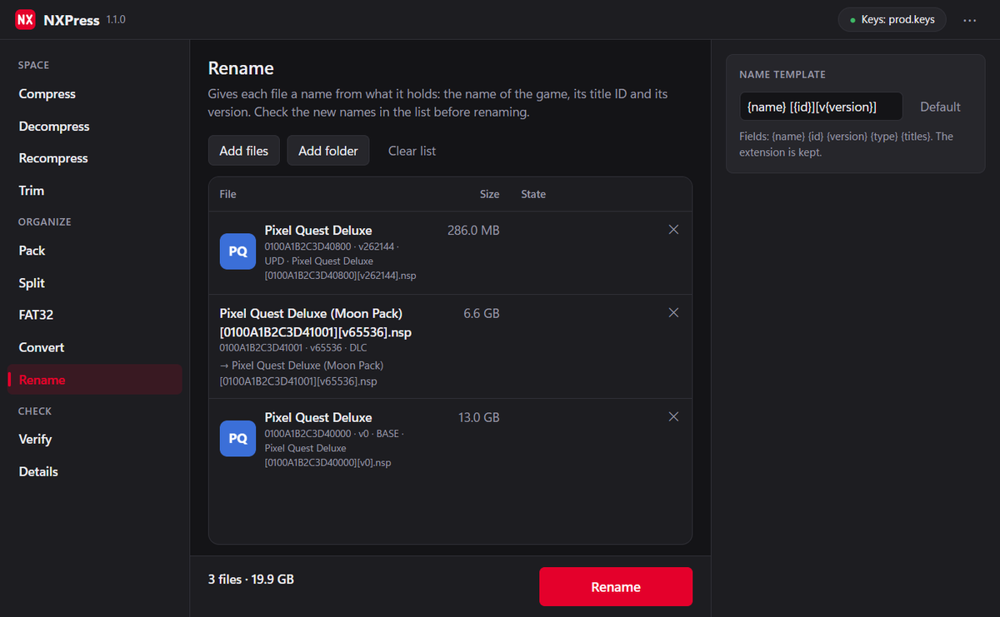
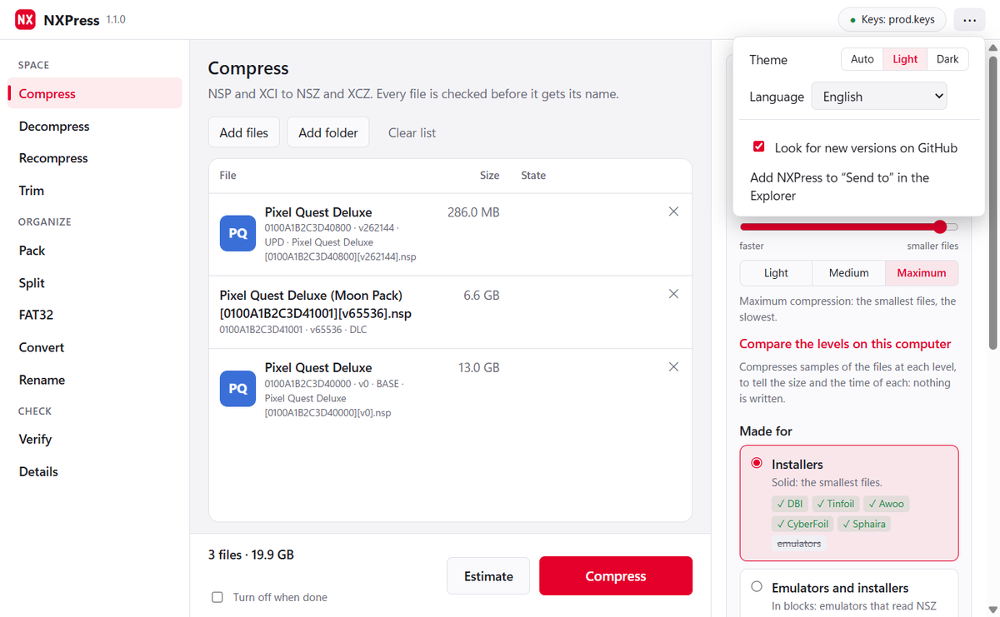

# NXPress

Compresses and decompresses Nintendo Switch NSP and XCI files to NSZ and XCZ, multi-title files (SuperNSP) included. It writes standard NSZ and XCZ, the same format nsz writes, so installers read them as usual.

It is one program with no Python or other dependencies. Opened with no arguments it shows a window: drop files or folders on it, choose what to do and start. With arguments it is a command line that takes the same options as nsz, so it can replace it in scripts and in tools that call nsz.



## Download

The program for Windows, macOS (Apple chip or Intel) and Linux (PC or ARM) is on the [releases page](https://github.com/DeLFuS77/NXPress/releases/latest). It needs your own `prod.keys`, dumped from your own console; none is included. Tested with DBI. On Linux, unpack it and run `install.sh` to put NXPress in the menu of applications with its icon.

## The window



Drop files or folders on the window, or on NXPress itself; on Windows it can add itself to "Send to" in the Explorer, so the files chosen there open in it. Each game shows with its name, icon, title ID and version. Its modes are grouped by what they are for:

- **Space**: compress, decompress, recompress (solid or in blocks, at another level, without the NSP in between) and trim (the padding of XCI files and the delta fragments of updates)
- **Organize**: pack a game, its updates and DLC into one SuperNSP or into its XCI; split them back, byte for byte; FAT32 parts for microSD cards; convert XCI to NSP; rename files by what they hold
- **Check**: verify files, also against a DAT of No-Intro and others, and see the details of a file: its titles, how it is stored and what it works with



While it works it can pause, keeps the computer awake, tells with a notice of the system when long work is done and can turn the computer off after. The files left unfinished when it was closed are offered when it opens again, and Copy report puts the result of every file on the clipboard, to paste in an issue.

| Details of a file | Rename by what a file holds |
|---|---|
|  |  |

It follows the light or dark theme of the system, or the one chosen in its menu, and speaks 11 languages: English, Spanish, French, German, Italian, Portuguese, Dutch, Russian, Japanese, Korean and Chinese.



NXPress goes on the internet for one thing only: the window asks GitHub whether a new version is out. It can be turned off in its menu; the command line never does it.

## Solid or in blocks

A solid NSZ (the default) is the smallest and every installer takes it (DBI, Tinfoil, Awoo, CyberFoil, Sphaira). With `-B`, or "Emulators and installers" in the window, it is written in blocks, which emulators that read NSZ can run as it is, without installing it; every installer but Awoo takes it too. XCZ files are always in blocks, as nsz writes them.

Every new file is written under a hidden name, checked, and only then given its name. With `--rm-source` the original is deleted only once its new file passed the check.

## Command line

```
nxpress -C game.nsp                 compress to game.nsz
nxpress -C -l 19 -t 8 -o out games  compress every NSP and XCI of a folder at level 19 into out
nxpress -D game.nsz                 decompress to game.nsp (an XCZ to an XCI)
nxpress -V game.nsz                 check a file
nxpress --split super.nsp           split a multi-title file into one file per title
nxpress --pack super.nsp a.nsp b.nsp  merge into one SuperNSP (with an XCI among them: an XCI with everything)
nxpress --convert game.xci          turn an XCI into an NSP
nxpress --recompress -B game.nsz    write an NSZ again in blocks (or -S, solid), no NSP in between
nxpress --trim game.xci update.nsp  take away the padding of an XCI and the delta fragments of an update
nxpress --estimate -l 19 game.nsp   tell the size and the time a compression would give
nxpress --estimate --levels game.nsp  the same at the levels 3 to 19, to choose one
nxpress --measure -l 18 game.nsp   try threads and files at once here, and tell the fastest for -t and -m
nxpress -i game.nsz                 show its titles, how it is stored and what it works with
nxpress -V --dat switch.dat games   tell which files are dumps a DAT (No-Intro) lists
nxpress --fat32 game.nsp            a file over 4 GB to a folder of parts for a FAT32 microSD (and back)
nxpress --rename "{name} [{id}][v{version}]" games   rename files by what they hold
nxpress -C --watch -o out inbox     compress every new file copied into inbox, until Ctrl+C
```

`nxpress --help` lists every option. The options of nsz work the same, so NXPress can take its place in scripts.

The keys are read from `--keys`, or from a `prod.keys` or `keys.txt` next to NXPress, in the working folder or in `~/.switch`.

## Building

NXPress needs Go and a C compiler (for zstd). The window uses [Wails](https://wails.io): WebView2 on Windows, WebKitGTK on Linux.

```
go run github.com/tc-hib/go-winres@v0.3.3 make --in build/winres/winres.json --arch amd64   # Windows: icon and manifest
go build -tags desktop,production -ldflags "-s -w" .                                # add webkit2_41 to the tags on Linux
```

The screenshots show made-up games.

## License

AGPL-3.0
