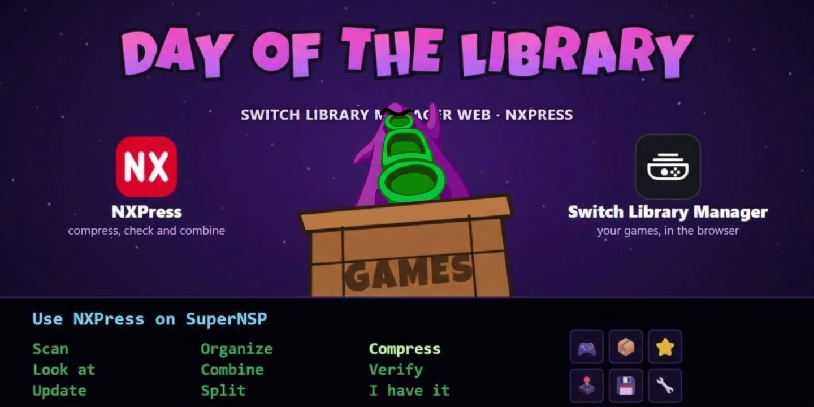
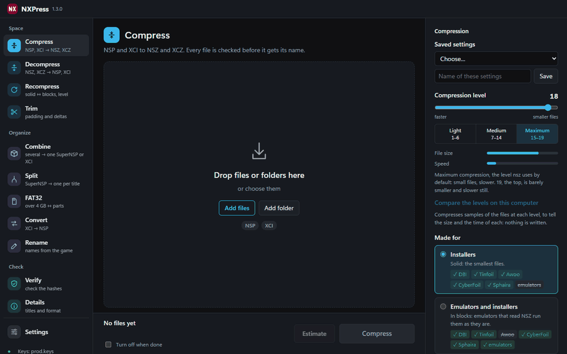
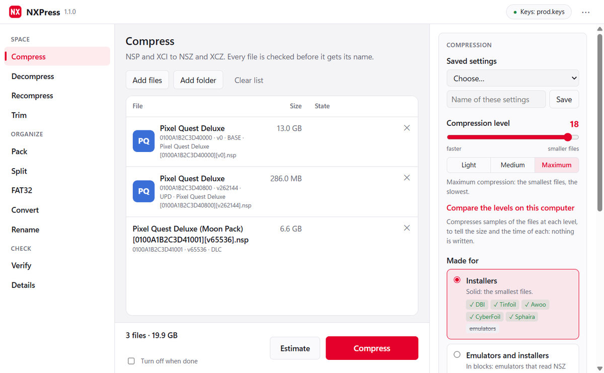
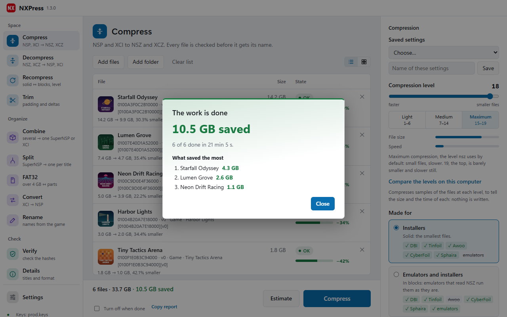
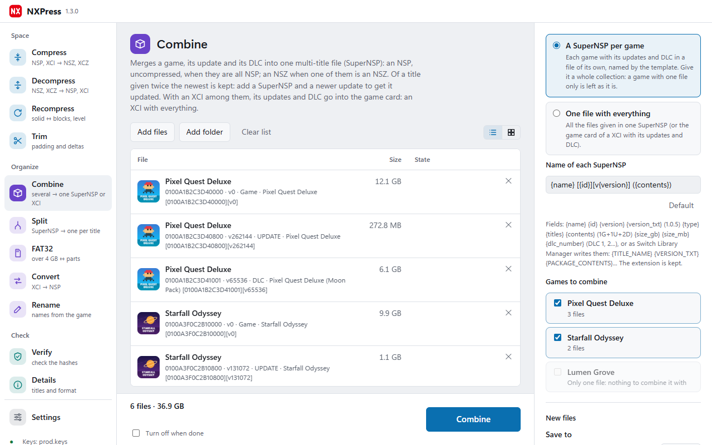
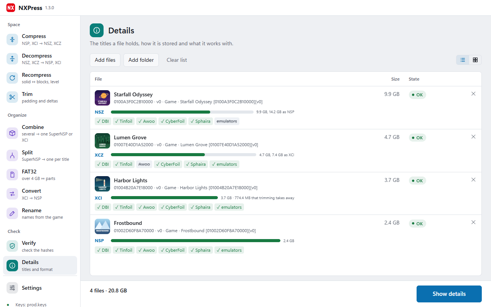
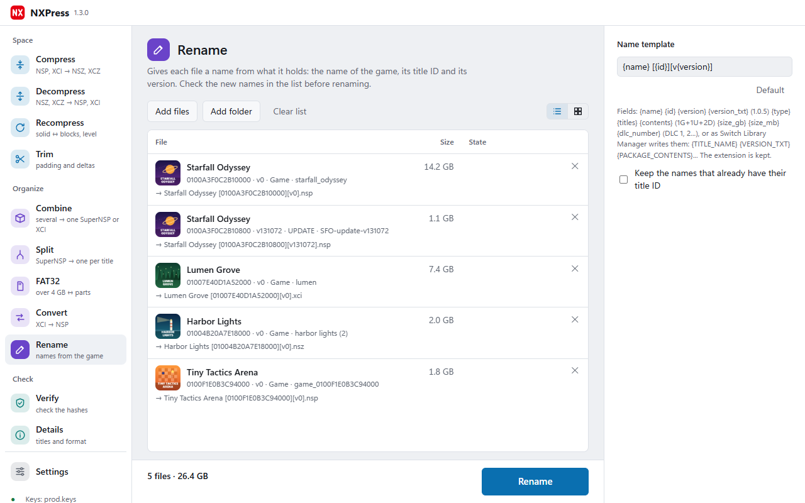
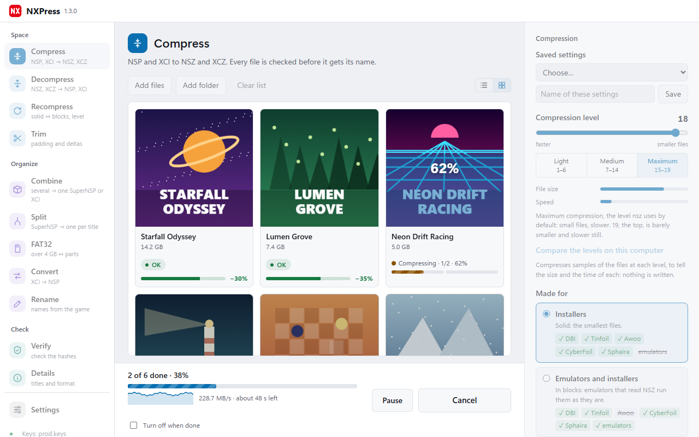

<p align="center"></p>

# NXPress

[](https://ko-fi.com/delfus77)
[](https://discord.gg/acQVZSEBR)
[](https://github.com/DeLFuS77/NXPress/releases)
[](https://github.com/DeLFuS77/NXPress/releases)
[](https://github.com/DeLFuS77/NXPress/actions/workflows/build.yml)
[](https://github.com/DeLFuS77/NXPress/blob/main/LICENSE)


Compresses and decompresses Nintendo Switch NSP and XCI files to NSZ and XCZ, multi-title files (SuperNSP) included. It writes standard NSZ and XCZ, the same format nsz writes, so installers read them as usual.

💬 Questions, ideas or news of new versions? Join the [Discord server](https://discord.gg/acQVZSEBR), shared with [Switch Library Manager Web](https://github.com/DeLFuS77/switch-library-manager-web).

<p align="center">
  <a href="https://ko-fi.com/delfus77"></a>
  <br>
  <sub>❤️ Free and open source, and it will stay free. If it saves you time, a coffee helps keep it going.</sub>
</p>

It is one program with no Python or other dependencies. Opened with no arguments it shows a window: drop files or folders on it, choose what to do and start. With arguments it is a command line that takes the same options as nsz, so it can replace it in scripts and in tools that call nsz.



## Download

The program for Windows, macOS (Apple chip or Intel) and Linux (PC or ARM) is on the [releases page](https://github.com/DeLFuS77/NXPress/releases/latest). It needs your own `prod.keys`, dumped from your own console; none is included. Tested with DBI.

On macOS the app is not notarized: the first time, open it with right click, Open (or allow it in System Settings, Privacy & Security). On Linux it needs GTK 3 and WebKitGTK 4.1, which most desktops have; once unpacked, `install.sh` puts NXPress in the menu of applications with its icon.

For Windows there is also a portable download (`…-windows-x64-portable.zip`): a folder with the program and its `settings` folder, ready to unpack anywhere. Any copy becomes portable with a folder named `settings` next to the program: NXPress then keeps its settings, its window and the files already checked in it, and nothing in your user folders. With `prod.keys` next to the program as well, the whole folder can go on a USB stick.

## The window

<picture>
  <source media="(prefers-color-scheme: dark)" srcset="docs/screenshots/compress-dark.png">
  
</picture>

Drop files or folders on the window, or on NXPress itself; on Windows it can add itself to "Send to" in the Explorer, so the files chosen there open in it. Each game shows with its cover, name, title ID and version, in a list or as a grid of covers; the list sorts by name, size or state, and each file has a menu on a right click. The menu on the left groups the sections by what they are for:

- **Space**: compress, decompress, recompress (solid or in blocks, at another level, without the NSP in between) and trim (the padding of XCI files and the delta fragments of updates)
- **Organize**: combine a game, its updates and DLC into one SuperNSP or into its XCI, or a whole collection into a SuperNSP per game, named by a template; split them back, byte for byte; FAT32 parts for microSD cards; convert XCI to NSP; rename files by what they hold
- **Check**: verify files by their hashes, by the signature of Nintendo or both, also against a DAT of No-Intro and others, and see the details of a file: its titles, how it is stored and what it works with. NUP files are verified and shown too, made of dump folders and turned back into folders, without keys (see [NUP files](#nup-files))

While it works, each file has its bar split in its steps (the work, then the check of what it wrote), the window tells the speed and the time left, and on Windows the button of the taskbar shows the progress. It can pause, keeps the computer awake, tells with a notice of the system when long work is done and can turn the computer off after. Before it starts it checks that the new files fit on each drive, and at the end a card tells the space saved and what saved the most. The files left unfinished when it was closed are offered when it opens again, and Copy report puts the result of every file on the clipboard, to paste in an issue.

<picture>
  <source media="(prefers-color-scheme: dark)" srcset="docs/screenshots/done-dark.png">
  
</picture>

| Combine, a SuperNSP per game | Details of a file |
|---|---|
| <picture><source media="(prefers-color-scheme: dark)" srcset="docs/screenshots/combine-dark.png"></picture> | <picture><source media="(prefers-color-scheme: dark)" srcset="docs/screenshots/details-dark.png"></picture> |
| **Rename by what a file holds** | **The list as a grid of covers** |
| <picture><source media="(prefers-color-scheme: dark)" srcset="docs/screenshots/rename-dark.png"></picture> | <picture><source media="(prefers-color-scheme: dark)" srcset="docs/screenshots/grid-dark.png"></picture> |

It follows the light or dark theme of the system, or the one chosen in Settings, and speaks 11 languages: English, Spanish, French, German, Italian, Portuguese, Dutch, Russian, Japanese, Korean and Chinese. Settings is a page of its own, with a sound when the work is done (the one of NXPress or one of your own) and the keyboard shortcuts. The log, under Check, keeps every work done with its files, and a text file of it in the settings folder.

NXPress goes on the internet for two things only, both from the window and each one can be turned off in Settings: it asks GitHub whether a new version is out, and once a day at most it downloads the list of the versions published of each game (versions.json, about 200 KB, the one Switch Library Manager Web uses), to tell the updates that are out and not in the list. Nothing of the list is sent. The command line never goes on the internet: `-i` tells the newest update published from the copy the window keeps.

## Solid or in blocks

A solid NSZ (the default) is the smallest and every installer takes it (DBI, Tinfoil, Awoo, CyberFoil, Sphaira). With `-B`, or "Emulators and installers" in the window, it is written in blocks, which emulators that read NSZ can run as it is, without installing it; every installer but Awoo takes it too. XCZ files are always in blocks, as nsz writes them.

The level goes from 1 to 19, in three bands: Light 1–6, Medium 7–14 and Maximum 15–19. 18, the default of nsz, is also the one of NXPress. "Compare the levels on this computer" tells the size and the time of each level from samples of the files, and "Measure this PC" tries threads and files at once and keeps the fastest.

Every new file is written under a hidden name, saved to the disk, checked, and only then given its name. With `--rm-source` the original is deleted only once its new file passed the check.

## Extra compression (experimental)

`--extra`, or "Extra compression, NXPress only" under Advanced, compresses two things other compressors leave as they are, and gives them back byte for byte:

- **Base games in sparse storage**, released cut down to go with their day-one update. The NCZ format cannot hold them, so nsz and every other compressor leave them as they are. NXPress writes them in an extension of NCZ, NCZSECT2, described in [docs/ncz-sparse.md](docs/ncz-sparse.md).
- **The data Nintendo compressed with LZ4** inside many recent games and updates, which zstd can hardly shrink. NXPress keeps those blocks decompressed and makes them again, byte for byte, with the two LZ4 compressors of Nintendo, when the file is decompressed: NCZSECT3, described in [docs/lz4-archive.md](docs/lz4-archive.md).

Each file gets what it needs, and one that needs neither stays a plain NSZ that every installer reads. Installers do not read the two extensions yet: decompress such a file with NXPress before installing it. `--sparse` and `--archive` turn on one half each.

## Command line

```
nxpress -C game.nsp                 compress to game.nsz
nxpress -C -l 19 -t 8 -o out games  compress every NSP and XCI of a folder at level 19 into out
nxpress -C --extra game.nsp         compress with the experimental extra compression, NXPress only
nxpress -D game.nsz                 decompress to game.nsp (an XCZ to an XCI)
nxpress -V game.nsz                 check a file
nxpress -V --verify-level signature games  check only the signature of every NCA, in seconds
nxpress --split super.nsp           split a multi-title file into one file per title
nxpress --pack super.nsp a.nsp b.nsp  merge into one SuperNSP (with an XCI among them: an XCI with everything)
nxpress --pack-one a.nsp b.nsp      the same, next to the files and named by --pack-name
nxpress --pack-games games         a SuperNSP per game of a folder, named by --pack-name
nxpress --convert game.xci          turn an XCI into an NSP
nxpress --recompress -B game.nsz    write an NSZ again in blocks (or -S, solid), no NSP in between
nxpress --trim game.xci update.nsp  take away the padding of an XCI and the delta fragments of an update
nxpress --estimate -l 19 game.nsp   tell the size and the time a compression would give
nxpress --estimate --levels game.nsp  the same at the levels 3 to 19, to choose one
nxpress --measure -l 18 game.nsp   try threads and files at once here, and tell the fastest for -t and -m
nxpress -i game.nsz                 show its titles, how it is stored and what it works with
nxpress -V --dat switch.dat games   tell which files are dumps a DAT (No-Intro) lists
nxpress -V game.nup                 check every file of a NUP by its SHA-256, without keys
nxpress -i game.nup                 show the packages of a NUP, with their files and sizes
nxpress --nup "Game dump"           pack a dump folder (base, updates, dlc) into a NUP next to it
nxpress -D game.nup                 turn a NUP back into a folder, each file checked by its SHA-256
nxpress --fat32 game.nsp            a file over 4 GB to a folder of parts for a FAT32 microSD (and back)
nxpress --rename "{name} [{id}][v{version}]" games   rename files by what they hold
nxpress -C --watch -o out inbox     compress every new file copied into inbox, until Ctrl+C
nxpress -C --low-priority games     compress at low priority, so the computer stays responsive
nxpress -C --recursive games        take the files in the folders inside too
```

`nxpress --help` lists every option. The options of nsz work the same, so NXPress can take its place in scripts.

The keys are read from `--keys`, or from a `prod.keys` or `keys.txt` next to NXPress, in the working folder or in `~/.switch`. NUP files need none.

## NUP files

NUP (`.nup`, [github.com/a55uka/nup](https://github.com/a55uka/nup)) is a container of decrypted Switch and Switch 2 games: a game, its updates and its DLC in one file, as plain files, each stored raw or compressed with zstd and with its own SHA-256. Nothing in it is encrypted, so NXPress reads it without keys:

- **Details** (`-i`) shows each package (the game, an update or a DLC) with its title ID, its version, the name and the publisher the file gives, its files and their size, uncompressed and as stored.
- **Verify** (`-V`) checks the hash of the table of contents, then reads each piece of data once and checks the SHA-256 of every file, decompressing the ones stored with zstd: in order on a hard disk, with several readers at once on an SSD, and the hashing on every thread. A damaged file is told by its path in its package. The code modules of each ExeFS (`main`, `rtld`, `sdk`, `subsdk0`...) are read by their headers too, as the loader of a game reads them: a dump that lost bytes of its code gives a NUP whose hashes match but whose game stops while it launches, and Verify tells the game to be dumped again. Verify takes dump folders too, and reads their code the same way; Combine does it before the NUP gets its name, and makes the NUP all the same, as the dump is, with the warning.
- **Combine** (`--nup`) packs a dump folder into a NUP: the layout the packer of the format reads (`base`, `updates/<version>`, `dlc/<title ID>/<index>`, or the `exefs` and `romfs` of one package) or the new one of OunceCake (`program/<index>`, whose control data gives the name, the publisher and the icon of the game). Each file is stored with zstd at level 3, as the packer of the format does, or as it is when zstd does not make it smaller; files with the same data are kept once, and the listings FTP clients leave are left out. The NUP is read back whole and checked before it gets its name.
- **Decompress** (`-D`) turns a NUP back into a folder in the layout the packer reads, each file checked by its SHA-256 as it is written. A folder there already is never written into, and a name that would climb out of its folder fails the work.
- **Rename** (`--rename`) names a NUP by what it holds, with the same fields as a game file: the name of the game, its title ID, the version of its newest update, the titles of each kind and its size.

The other works leave NUP files as they are, and say where they are made, unpacked, verified and renamed.

## Building

NXPress needs Go and a C compiler (for zstd). The window uses [Wails](https://wails.io): WebView2 on Windows, WebKitGTK on Linux.

```
go run github.com/tc-hib/go-winres@v0.3.3 make --in build/winres/winres.json --arch amd64   # Windows: icon and manifest
go build -tags desktop,production -ldflags "-s -w" .                                # add webkit2_41 to the tags on Linux
```

The screenshots show made-up games.

## More

The [wiki](https://github.com/DeLFuS77/NXPress/wiki) has a guide to each section, which installers and emulators read each format, every option of the command line, frequent questions and what to do when something fails. For help, ideas and news of new versions there is also a [Discord server](https://discord.gg/acQVZSEBR), shared with Switch Library Manager Web.

## License

AGPL-3.0
